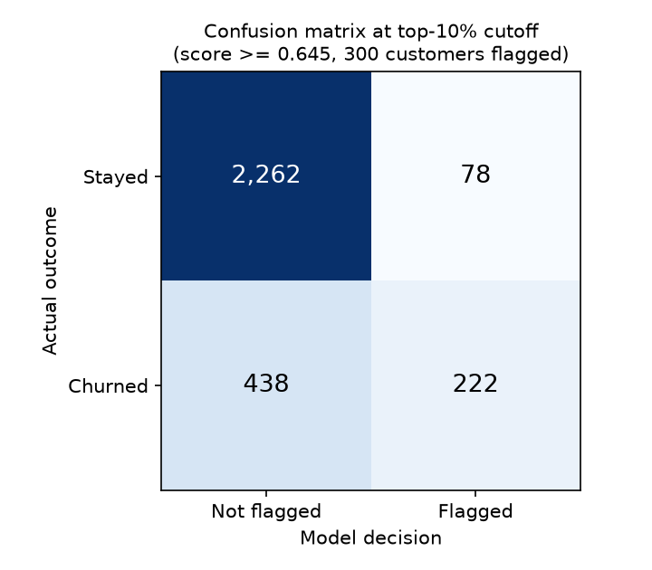
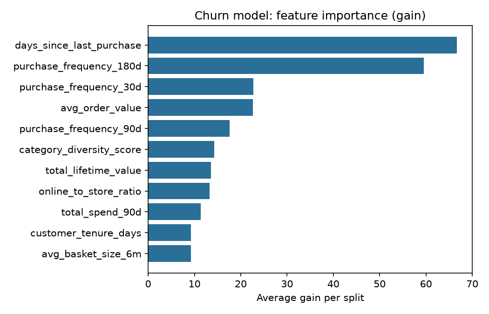

# Lab 3 Task 1: Churn Model Evaluation Report

The headline results, confusion matrix, feature importance and slice table all come from one
graded run, and its numbers appear in four places: this report,
[`lab3-evidence/evaluation_metrics.json`](lab3-evidence/evaluation_metrics.json), MLflow run
`xgb-d4-eta0.1-final` and the metadata of Model Registry version 2. Comparison figures from the
other MLflow runs and the course reference are labelled where they appear.

| | |
|---|---|
| Graded run | `xgb-d4-eta0.1-final`, MLflow run `5de1d844a80440cca81181c49318a04c` (experiment `northstar-churn`) |
| Console log | [`lab3-evidence/train-final.log`](lab3-evidence/train-final.log) |
| Training data | Feature Store offline store via Athena, query `8ff30761-68e5-4168-aee5-7fd4e6d05d90` (682,222 bytes scanned; [`athena-query.json`](lab3-evidence/athena-query.json)); 9,999 customers, newest record per customer, soft-deleted customers excluded; data SHA-256 `0ce8644a…2405866` |
| Registry | `northstar-churn-models` v2, **PendingManualApproval** ([`model-registry.json`](lab3-evidence/model-registry.json)) |
| Model | XGBoost 3.4.1, `max_depth` 4, `eta` 0.1, `num_round` 200 with early stopping (20 rounds, on inner-validation AUC), best iteration 51, `min_child_weight` 5, `subsample` 0.8, `colsample_bytree` 0.8, seed 42 |
| Split | Stratified 70/30 by customer: 3,000 test customers, untouched until final scoring. The 6,999 training customers are split again: 5,949 to fit and 1,050 for early stopping and for choosing between configurations |
| Features | The 11 RFM and behavioural features. `churn_label`, `customer_id`, `loyalty_tier` and `churn_risk_score` are excluded |

## Results

| Metric | Value | Threshold | Result |
|---|---|---|---|
| AUC-ROC (test set) | **0.7831** | report it; no fixed threshold | reported |
| Precision @ top 10% | **0.7400** (222 of 300) | ≥ 0.50 | pass |
| Recall @ top 10% | **0.3364** (222 of 660 churners) | ≥ 0.25 | pass |
| AUC lift over recency-only baseline | **+0.0590**, 95% CI **[0.0397, 0.0795]** | CI must exclude zero | pass |

**The baseline** is an XGBoost model trained on `days_since_last_purchase` alone, on the same
5,949 training customers and scored on the same 3,000 test customers. It reaches AUC **0.7242**.
The interval is a paired bootstrap of the test set: 2,000 replicates (seed 42), and in each one
the rows are resampled once and both models are scored on them, so the interval describes the
difference itself. It captures test-set sampling only, not variation from a different
train/test split.

**Comparison with the course reference** (XGBoost 3.2.0: 0.7696 full, 0.7233 baseline,
lift +0.0464, CI [0.0254, 0.0670], precision 0.6833, recall 0.3106). Our baseline matches the
reference to within 0.001, which suggests the same data and split. The full model is higher, most
likely because of configuration (depth 4 with early stopping on an inner validation split). It
was also trained on XGBoost 3.4.1, a different version from the reference.

**Recall ceiling.** With 660 churners among 3,000 test customers, a 300-customer list can catch at
most 300 / 660 = 0.45 of them. A recall of 0.336 captures about 74% of what that budget allows.

**Class imbalance.** About 22% of customers are positives. `scale_pos_weight` is computed from the
training split as negatives / positives = **3.545**, not hardcoded. That gives the two classes
equal total weight, so the loss is not dominated by the 78% majority. The trade-off is that the
output is a ranking score, not a calibrated probability. At a 0.5 cutoff the model flags 1,093
customers when only 660 churn, which is why the operating point is the top 10% by rank.

## Confusion matrix at the chosen threshold

The operating point is the business one: contact the **top 10% of customers by score**. That is
exactly 300 of 3,000, chosen by rank, which equals a score of at least 0.6446. Ties at the cutoff
do not enlarge the list.

| | Not flagged | Flagged |
|---|---|---|
| **Stayed** | 2,262 | 78 |
| **Churned** | 438 | 222 |

For comparison, the 0.5 probability cutoff flags 1,093 customers (TP 434, FP 659, FN 226, TN 1,681).

## Feature importance

Average gain per split, from the registered model:

| Feature | Gain | | Feature | Gain |
|---|---|---|---|---|
| days_since_last_purchase | 66.69 | | category_diversity_score | 14.25 |
| purchase_frequency_180d | 59.55 | | total_lifetime_value | 13.61 |
| purchase_frequency_30d | 22.75 | | online_to_store_ratio | 13.25 |
| avg_order_value | 22.61 | | total_spend_90d | 11.38 |
| purchase_frequency_90d | 17.58 | | customer_tenure_days | 9.23 |
| | | | avg_basket_size_6m | 9.22 |

Recency and 180-day frequency carry most of the signal. Tenure and basket size are close to
decorative. Gain is a ranking, not proof that a feature is useless: I did not drop features one
at a time. These gains come from the model trimmed to its 52 best trees. An earlier export of the
same predictions showed lower averages (51.4 and 45.2), because it still contained 20 extra
trees from after early stopping.

**With and without `churn_risk_score`.** That score is a pure recency heuristic, and it overlaps
the baseline. At the graded configuration, adding it gives AUC 0.7858 against 0.7831,
precision@10% 0.7167 against 0.7400, and recall@10% 0.3258 against 0.3364 (MLflow run
`xgb-d4-eta0.1-risk`, ID `06630ff4c77c4f2198e7ed03a97a180d`; output and log in
[`docs/lab_3/results/xgb-d4-eta0.1-risk/`](results/xgb-d4-eta0.1-risk/)).
A depth-6 pair gave 0.7784 against 0.7787. Neither shows a consistent gain. AUC and
inner-validation AUC (0.7855 against 0.7848) tick up slightly, but on the 300 customers the
business would actually contact it does worse (215 churners caught instead of 222). I left it
out, so the recency baseline comparison stays clean.

## Slice evaluation by loyalty tier

[`lab3-evidence/slice-evaluation.csv`](lab3-evidence/slice-evaluation.csv), test set (n = 3,000):

| Tier | n | Positives | Churn rate | AUC [95% CI] | Recall @10% (global list) | Recall @10% (within tier) | Too small? |
|---|---|---|---|---|---|---|---|
| Bronze | 1,071 | 361 | 33.7% | 0.753 [0.722, 0.787] | 0.443 | 0.288 | no |
| Silver | 1,139 | 226 | 19.8% | **0.718** [0.679, 0.756] | 0.230 | 0.252 | no |
| Gold | 483 | 52 | 10.8% | 0.758 [0.685, 0.824] | 0.135 | 0.385 | no |
| Platinum | 307 | **21** | 6.8% | 0.873 [0.808, 0.927] | 0.143 | 0.524 | **yes** (< 30 positives) |

**Weakest tier: Silver.** It has the lowest AUC, 0.718, and with 226 positives that is a real
finding. Its interval overlaps Bronze's and Gold's, so it is the weakest by a modest margin, not
a broken slice. Silver also churns at a middling 19.8%, which may be why it is hardest to rank:
its customers sit between the clearly lapsing Bronze members and the engaged Gold ones.
Features that separate Silver customers better, such as spend trend, or a tier-specific model
would be the first thing to try. Feeding `loyalty_tier` itself in as a feature would make this
fairness check circular.

**Two recalls, because they answer different questions.** "Global" is the share of a tier's
churners caught by the single company-wide top-10% list, which is what the retention team gets.
It is driven largely by base rate: Bronze churns at 34% and fills the list, while Gold and
Platinum churners are rarer and mostly fall below the global cutoff. Gold (0.135), Platinum
(0.143) and Silver (0.230) are more than 10 points below the 0.336 aggregate on that measure.
"Within tier" contacts the top 10% of each tier separately and isolates ranking quality. By that
measure no tier is flagged, and Gold (0.385) and Platinum (0.524) rank well. If the business wants
high-value tiers covered, it needs per-tier quotas, not a better model.

**Too small to conclude from: Platinum.** It has 307 customers but only 21 churners. Its AUC of
0.873 looks like the best of any tier, but 21 positives cannot support that claim. The interval
is wide, and on a smaller version of this dataset the Platinum AUC swung between 0.00 and 1.00
from the random split alone. I report it and draw no conclusion from it.

## Experiment tracking

Six runs in the MLflow App, varying depth, learning rate, number of rounds and the risk score.
Among the configurations **without** `churn_risk_score`, I chose on the **inner validation AUC**,
not the test set, so the test numbers above were not tuned to it. Leaving out the risk score was
decided up front, not by tuning: it is a recency heuristic that duplicates the baseline. The two
risk-score runs are reported as the with/without comparison. Including it would in fact have
nudged inner-validation AUC up (0.7855 against 0.7848), while the top-10% list got worse.

| Run | max_depth | eta | num_round | risk score | best iter | val AUC (inner) | test AUC | P@10% | R@10% |
|---|---|---|---|---|---|---|---|---|---|
| xgb-d6-eta0.1 | 6 | 0.1 | 200 | no | 51 | 0.7832 | 0.7787 | 0.680 | 0.309 |
| xgb-d4-eta0.1 | 4 | 0.1 | 200 | no | 51 | **0.7848** | 0.7831 | 0.740 | 0.336 |
| xgb-d3-eta0.05 | 3 | 0.05 | 400 | no | 6 | 0.7625 | 0.7731 | 0.737 | 0.335 |
| xgb-d6-eta0.1-risk | 6 | 0.1 | 200 | yes | 4 | 0.7689 | 0.7784 | 0.693 | 0.315 |
| xgb-d4-eta0.1-risk | 4 | 0.1 | 200 | yes | 52 | 0.7855 | 0.7858 | 0.717 | 0.326 |
| **xgb-d4-eta0.1-final** (graded, registered v2) | 4 | 0.1 | 200 | no | 51 | 0.7848 | 0.7831 | 0.740 | 0.336 |

`xgb-d4-eta0.1-final` is the selected configuration, rerun on the rebuilt stack with its
console log captured. It reproduced the original run to four decimal places. Two runs (d3 and
d6-risk) had best iterations of only 6 and 4, so training halted around rounds 26 and 24. That
shows that 20 rounds of patience on about 1,050 validation customers is a noisy stopping rule.
It did not affect the selected run, whose best iteration was 51 (training halted at round 71 and
the saved model keeps the first 52 trees). Registry v1 holds an earlier execution of the same
configuration with identical metrics. It was registered before run IDs were written to the
metadata, and its MLflow run is not among the six exported. v2 is the graded run, linked to MLflow
run `5de1d844…` through `mlflow_run_id`. The evidence collector's registry check names v1 only
because it reports the oldest version whose metrics match, and both versions match.
